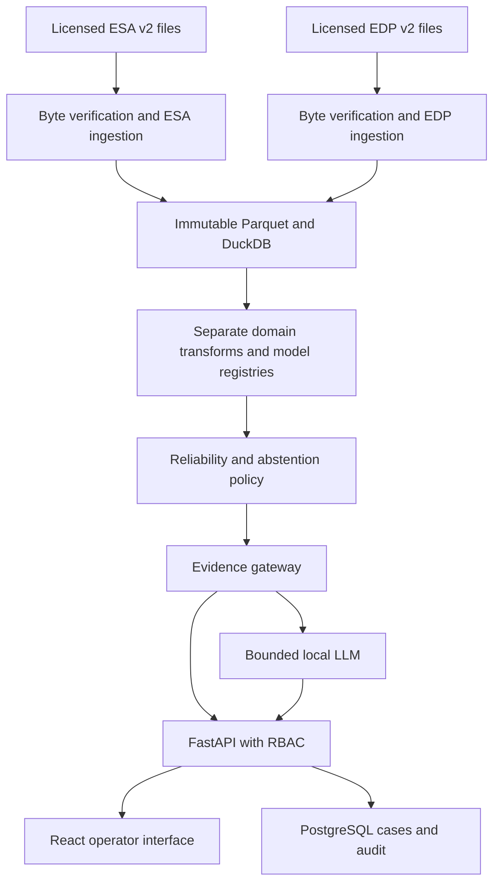

# Architecture

## Implemented at G0

`src/sovereign_ops/api.py` exposes liveness and OpenAPI. `contracts.py` contains
immutable Pydantic shapes; `adapters.py` contains Python Protocol interfaces for
ESA and EDP; `audit.py` defines ingest event validation and a persistence interface.
No adapter or audit sink implementation exists. No background work or downloads
occur on application import or startup.

## Target design — not implemented

Domain adapters retain source IDs, units, timestamps, filtering provenance, and
failure/event identity. Shared contracts do not imply shared sensor physics.
Model evidence includes data, model, and protocol hashes, training window,
calibration version, and source citations. Exact derived-data lineage and model
promotion records are G1/G2 deliverables, not fabricated G0 manifests.

`AcquisitionManifest` describes an acquisition receipt. `DATASET_REGISTRY.json`
describes sources that have not been downloaded and cannot be used as a receipt.
The adapter implementation must fail before yielding any telemetry if rights,
hashes, schema, dataset identity, or audit persistence cannot be verified.

G1 extends provenance with timestamp conventions, parsing rules, dictionary,
frequency, coverage, missingness, duplicates, derived hashes, and a lineage DAG.

## Trust boundaries

External source files and retrieved text are untrusted. Validate outside API
request processing with bounded storage and memory. Never deserialize arbitrary
pickle/model files just because they came from a recognised hostname. Review ESA
archive formats in a constrained environment before choosing a parser.

No browser or LLM may access a database directly. API authorization will enforce
asset scope and analyst/reviewer/admin roles. Signed evidence verification is
planned; no signing system exists at G0. Case mutation must carry authenticated
actor identity and a durable audit acknowledgement. LLM outage must not disable
non-LLM browsing and review. PostgreSQL, Docker, observability, UI, auth, and
rollback are later gates.
