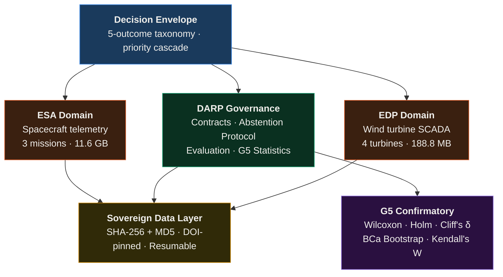

# SOVEREIGN OPS 2.0

**Domain-Aware Reliability Protocol — Abstention-First Anomaly Detection with Cryptographic Provenance**

[](https://doi.org/10.5281/zenodo.24364517)
[](https://github.com/rolffcoelho-bravo/sovereign-ops-2.0/actions)
[](https://www.python.org/downloads/release/python-3120/)
[](LICENSE)
[](#development-status)
[](#technology-stack)

## Research question

> Can a common, independently audited *reliability decision protocol* control alerting and abstention across fundamentally different high-dimensional systems — spacecraft telemetry and wind-turbine SCADA — while preserving domain-specific physical models and event definitions?

Most cross-domain anomaly detection work either trains a universal model (which silently degrades on out-of-distribution regimes) or stays within a single domain. **Sovereign Ops** takes a different approach: the *governance layer* — contracts, abstention rules, evidence provenance, and evaluation protocol — is shared; the *physics* stays separate.

## Why this matters

Mission-critical systems need more than anomaly scores. They need to know **when not to answer**. A turbine SCADA system with 40% missing data in the analysis window should return `ABSTAIN_INSUFFICIENT_EVIDENCE`, not a low-confidence alert that an operator might act on.

Sovereign Ops implements a **five-outcome decision envelope** with explicit abstention:

| Outcome | Meaning |
|---|---|
| `BLOCK_DATA_INTEGRITY` | Source provenance or hash verification failed (P1 — halt) |
| `DEGRADED_SERVICE` | Upstream component unavailable (P2 — degrade) |
| `ABSTAIN_INSUFFICIENT_EVIDENCE` | Data quality or coverage too low to decide (P3 — abstain) |
| `SUPPORTED_ALERT` | Evidence supports anomaly investigation (P4 — actionable) |
| `INVESTIGATE` | Mixed evidence; human review warranted (P5 — review) |

Each decision carries typed evidence citations, model provenance hashes, and an explicit abstention reason when applicable — a structured vocabulary for "I don't know" in production systems.

## Novel methodology: 5-layer confirmatory evaluation (G5)

The core research contribution is a **Domain-Aware Reliability Protocol (DARP)** with a 5-layer non-parametric confirmatory evaluation pipeline — a combination not found in standard ML evaluation:

| Layer | Method | Purpose |
|---|---|---|
| **L1** | Wilcoxon signed-rank | Non-parametric paired comparison (exact enumeration ≤ 25, normal approx > 25) |
| **L2** | Holm–Bonferroni | Step-down FWER correction across all pairwise comparisons |
| **L3** | Cliff's delta (δ) | Non-parametric ordinal effect size [-1, +1] with Romano et al. 2006 thresholds |
| **L4** | BCa bootstrap CI | Bias-corrected and accelerated confidence intervals (10,000 resamples) |
| **L5** | Kendall's W | Rank concordance across chronological splits for stability assessment |

**What makes DARP different from standard practice:**

| Capability | Standard Practice | Advanced ML Eval | DARP (This Work) |
|---|---|---|---|
| Significance testing | ✓ | ✓ | ✓ |
| FWER control | — | partial | ✓ |
| Effect size (Cliff's δ) | — | ✓ | ✓ |
| Bootstrap CI (BCa) | — | partial | ✓ |
| Rank stability | — | — | ✓ |
| Cryptographic provenance | — | — | ✓ |
| Domain isolation | — | — | ✓ |
| Abstention-aware eval | — | — | ✓ |

All 5 layers produce immutable Pydantic contracts with SHA-256 provenance chains, making the entire evaluation pipeline fully auditable and reproducible.

## Architecture



**Key architectural decisions:**
- **Contract-first design:** All data flows through immutable Pydantic models (`extra="forbid"`, `frozen=True`). `canonical_json()` + `sha256_digest()` for deterministic hashing.
- **Domain isolation:** Evidence cannot cross domain boundaries (enforced at the type level). No ESA model output ever enters an EDP decision envelope.
- **Cryptographic provenance:** SHA-256 chains from source bytes through every decision. DOI-pinned datasets with dual-hash verification.
- **Abstention-aware scoring:** Precision/recall/F1 computed only over non-abstaining subsets; coverage = 1 − abstention_rate.
- **Historical replay only:** This is a research platform for offline analysis. No connection to live satellites, wind farms, or industrial controls.

## Core domains

| Domain | Dataset | Scale | License |
|---|---|---|---|
| **Space** | ESA Anomaly Dataset v2 ([Zenodo](https://zenodo.org/records/15237121)) | 11.6 GB, 3 missions | CC BY 3.0 IGO |
| **Energy** | EDP Onshore Wind Farm SCADA v2 ([Mendeley](https://data.mendeley.com/datasets/zjxjnjp3xs/2)) | 188.8 MB, 4 SCADA turbines | CC BY 4.0 |

Additional domains (Scania fleet, HAI security testbed, TraCSS orbital) are registered but deferred until core governance works end-to-end.

## Development status

**60% complete — 6 of 10 gates passed.** 365 tests · 27 source modules · 6,490 lines · mypy --strict

| Gate | Status | Description | Tests |
|---|---|---|---|
| **G0** | ✅ COMPLETE | Foundation — contracts, API skeleton, CI, threat model | 38 |
| **G1** | ✅ COMPLETE | Data sovereignty — cryptographic provenance, DOI-pinned acquisition | 72 |
| **G2** | ✅ COMPLETE | Structural audit — domain parsers, quality profiler, schema validation | 110 |
| **G3** | ✅ COMPLETE | Baseline models — Z-Score (MAD), Isolation Forest, abstention-aware eval | 169 |
| **G4** | ✅ COMPLETE | DARP core — pipeline orchestrator, decision engine, evidence chains | 199 |
| **G5** | ✅ COMPLETE | Confirmatory eval — 5-layer statistical pipeline (Wilcoxon, Holm, Cliff's δ, BCa, Kendall's W) | 365 |
| **G6** | 🔵 IN PROGRESS | Observability — structured logging, metrics export | — |
| G7 | ⬜ PLANNED | Containerization — Docker, reproducible environments | — |
| G8 | ⬜ PLANNED | Documentation — technical report, scientific paper | — |
| G9 | ⬜ PLANNED | Publication — Zenodo archive, R/Python packages | — |

**Dashboard:** [Interactive Research Dashboard](https://rolffcoelho-bravo.github.io/SOVEREIGN-OPS-2.0/dashboard.html) — live metrics, architecture diagrams, methodology visualization

## Quick start

**Requirements:** Python 3.12, [uv](https://docs.astral.sh/uv/) ≥ 0.13.6

```bash
# Clone and install
git clone https://github.com/rolffcoelho-bravo/sovereign-ops-2.0.git
cd sovereign-ops-2.0
uv sync --locked

# Run the full verification suite
uv run --locked pytest                # 365 tests
uv run --locked mypy --strict src/    # strict type checking
uv run --locked ruff check .          # lint
uv run --locked ruff format --check . # format verification

# Start the API (development)
uv run --locked uvicorn sovereign_ops.api:app --host 127.0.0.1 --port 8000
curl http://127.0.0.1:8000/health/live
# → {"status":"alive","stage":"G5","mode":"RESEARCH_ONLY","inference":"NOT_IMPLEMENTED"}
```

For the complete 7-step verification pipeline:

```bash
uv run --locked python scripts/verify.py
```

## Repository structure

```
sovereign-ops-2.0/
├── src/sovereign_ops/         # Python package (27 modules, 6,490 lines)
│   ├── contracts.py           # Immutable Pydantic contracts (22 frozen types)
│   ├── schemas.py             # Domain-specific schema definitions
│   ├── adapters.py            # Domain adapter protocols
│   ├── api.py                 # FastAPI application (12 endpoints)
│   ├── esa_parser.py          # ESA telemetry parser (475 lines)
│   ├── edp_parser.py          # EDP SCADA parser (386 lines)
│   ├── esa_acquisition.py     # ESA dataset acquisition pipeline
│   ├── edp_acquisition.py     # EDP dataset acquisition pipeline
│   ├── source_verifier.py     # Cryptographic source verification
│   ├── quality_profiler.py    # Data quality profiling engine
│   ├── detectors.py           # Z-Score (MAD) + Isolation Forest (337 lines)
│   ├── splits.py              # Chronological train/cal/test splits
│   ├── evaluation.py          # Abstention-aware P/R/F1 evaluation
│   ├── pipeline.py            # DARP pipeline orchestrator (290 lines)
│   ├── decision_engine.py     # Five-outcome decision envelope (286 lines)
│   ├── statistics.py          # 5-layer confirmatory pipeline (1,138 lines)
│   ├── comparative.py         # Multi-detector comparison runner
│   ├── edp_source_audit.py    # EDP source integrity audit (319 lines)
│   ├── edp_view_comparison.py # EDP view comparison analysis
│   ├── edp_exposure.py        # EDP exposure sensitivity analysis
│   ├── edp_source_schemas.py  # EDP source schema definitions
│   ├── edp_events.py          # EDP event extraction
│   ├── edp_duplicates.py      # EDP duplicate detection
│   ├── edp_version_audit.py   # EDP version audit
│   ├── edp_source_values.py   # EDP source value analysis
│   └── audit.py               # Cross-module audit utilities
├── tests/                     # 24 test modules (365 tests, synthetic fixtures)
├── scripts/                   # Verification, acquisition, figure generation
│   ├── verify.py              # 7-step CI verification runner
│   └── generate_figures.py    # Publication-quality matplotlib figures
├── docs/                      # Dashboard, figures, gate reports
│   ├── dashboard.html         # Interactive research dashboard (GitHub Pages)
│   └── figures/               # 8 SVG + PNG publication figures
├── evidence/                  # Machine-readable verification artifacts
└── .github/workflows/         # CI pipeline (7-step)
```

## G5 statistical contracts

The confirmatory evaluation pipeline produces 8 immutable contract types:

| Contract | Fields | Purpose |
|---|---|---|
| `DetectorScore` | model_id · split_index · f1 · coverage · dataset_id | Per-split detector performance |
| `PairwiseTest` | model_a · model_b · statistic · p_value · n_pairs | Wilcoxon signed-rank result |
| `CorrectedTest` | rank · raw_p · corrected_p · rejected · alpha | Holm-Bonferroni corrected p-value |
| `CliffsDeltaResult` | delta · magnitude · pair · n_comparisons | Non-parametric effect size |
| `BootstrapCI` | lower · upper · confidence · method · n_resamples | BCa confidence interval |
| `EffectSizeReport` | pairwise deltas · bootstrap CIs · dataset_id | Aggregated effect analysis |
| `RankStabilityReport` | kendall_w · interpretation · n_splits · n_models | Rank concordance assessment |
| `ComparisonReport` | SHA-256 provenance · full pipeline output | Sealed, audit-ready comparison |

## Project documentation

| Document | Purpose |
|---|---|
| [**Research Dashboard**](https://rolffcoelho-bravo.github.io/SOVEREIGN-OPS-2.0/dashboard.html) | Interactive project frontpage with live metrics |
| [Product Contract](PRODUCT_CONTRACT.md) | 8 binding boundaries the system must respect |
| [Architecture](ARCHITECTURE.md) | Implemented vs. target design, trust boundaries |
| [Evaluation Protocol](EVALUATION_PROTOCOL.md) | 5-layer confirmatory pipeline specification |
| [Threat Model](THREAT_MODEL.md) | Attack surfaces and mitigations |
| [Dataset Registry](DATASET_REGISTRY.md) | Source metadata, DOIs, access constraints |
| [Data Rights](DATA_RIGHTS.md) | License audit per dataset |
| [G0 Report](docs/G0_REPORT.md) | Foundation gate — completion evidence |
| [G1 Report](docs/G1_REPORT.md) | Data sovereignty gate — completion evidence |

## Public and private boundary

This repository (`SOVEREIGN-OPS-2.0`) contains the open research platform. Proprietary algorithms, commercial methods, and sensitive configurations live in a separate private repository. The public project is fully functional without private components.

**Data policy:** Raw datasets are never committed. Acquisition scripts download from original sources with cryptographic verification. All derived artifacts are traceable to their source DOI and file hashes.

## Technology stack

| Layer | Technology |
|---|---|
| Language | Python 3.12 (strict typing, `mypy --strict`) |
| Contracts | Pydantic v2 (immutable, `extra="forbid"`, `frozen=True`) |
| API | FastAPI (async REST, 12 endpoints) |
| Data | Polars, PyArrow, Parquet |
| ML | scikit-learn, NumPy, SciPy |
| Statistics | Custom 5-layer non-parametric pipeline (1,138 lines) |
| Visualization | matplotlib (publication-quality figures) |
| CI | GitHub Actions (ruff → format → mypy → pytest → smoke → secrets → audit) |
| Package management | uv (locked, reproducible) |
| Reproducibility | Zenodo (DOI-pinned), SHA-256 provenance chains |

## Citation

If you use this work, please cite:

```bibtex
@software{shockbridgepulse_sovereign_ops_2026,
  author       = {Pereira, Rodolfo},
  title        = {Sovereign Ops: Domain-Aware Reliability Protocol for
                  Mission-Critical Anomaly Detection},
  year         = {2026},
  organization = {ShockBridge Pulse Research Lab},
  url          = {https://github.com/rolffcoelho-bravo/sovereign-ops-2.0},
  doi          = {10.5281/zenodo.24364518},
  version      = {0.1.0},
  note         = {Research software, gated development, 5-layer confirmatory evaluation}
}
```

## License

Apache License 2.0. See [LICENSE](LICENSE) for details.

Dataset licenses are separate and documented in [DATA_RIGHTS.md](DATA_RIGHTS.md).

---

*ShockBridge Pulse Research Lab · [shockbridgepulse.com](https://shockbridgepulse.com)*
