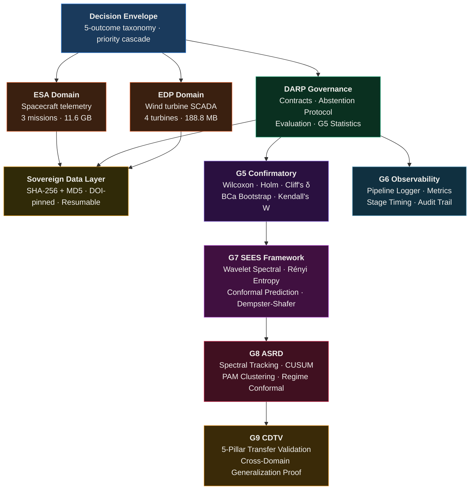

# SOVEREIGN OPS 2.0

**Domain-Aware Reliability Protocol — Abstention-First Anomaly Detection with Cryptographic Provenance**

[](https://doi.org/10.5281/zenodo.24364517)
[](https://github.com/rolffcoelho-bravo/sovereign-ops-2.0/actions)
[](https://www.python.org/downloads/release/python-3120/)
[](LICENSE)
[](#development-status)
[](#technology-stack)

## Research question

> Can a common, independently audited *reliability decision protocol* control alerting and abstention across fundamentally different high-dimensional systems — spacecraft telemetry and wind-turbine SCADA — while preserving domain-specific physical models and event definitions?

Most cross-domain anomaly detection work either trains a universal model (which silently degrades on out-of-distribution regimes) or stays within a single domain. **Sovereign Ops** takes a different approach: the *governance layer* — contracts, abstention rules, evidence provenance, and evaluation protocol — is shared; the *physics* stays separate.

## Why this matters

Mission-critical systems need more than anomaly scores. They need to know **when not to answer**. A turbine SCADA system with 40% missing data in the analysis window should return `ABSTAIN_INSUFFICIENT_EVIDENCE`, not a low-confidence alert that an operator might act on.

Sovereign Ops implements a **five-outcome decision envelope** with explicit abstention:

| Outcome | Meaning |
|---|---|
| `BLOCK_DATA_INTEGRITY` | Source provenance or hash verification failed (P1 — halt) |
| `DEGRADED_SERVICE` | Upstream component unavailable (P2 — degrade) |
| `ABSTAIN_INSUFFICIENT_EVIDENCE` | Data quality or coverage too low to decide (P3 — abstain) |
| `SUPPORTED_ALERT` | Evidence supports anomaly investigation (P4 — actionable) |
| `INVESTIGATE` | Mixed evidence; human review warranted (P5 — review) |

Each decision carries typed evidence citations, model provenance hashes, and an explicit abstention reason when applicable — a structured vocabulary for "I don't know" in production systems.

## Novel methodology

### I. 5-layer confirmatory evaluation (G5)

The first methodological pillar is a **5-layer non-parametric confirmatory evaluation pipeline** — a combination not found in standard ML evaluation:

| Layer | Method | Purpose |
|---|---|---|
| **L1** | Wilcoxon signed-rank | Non-parametric paired comparison (exact enumeration ≤ 25, normal approx > 25) |
| **L2** | Holm–Bonferroni | Step-down FWER correction across all pairwise comparisons |
| **L3** | Cliff's delta (δ) | Non-parametric ordinal effect size [-1, +1] with Romano et al. 2006 thresholds |
| **L4** | BCa bootstrap CI | Bias-corrected and accelerated confidence intervals (10,000 resamples) |
| **L5** | Kendall's W | Rank concordance across chronological splits for stability assessment |

**What makes DARP different from standard practice:**

| Capability | Standard Practice | Advanced ML Eval | DARP (This Work) |
|---|---|---|---|
| Significance testing | ✓ | ✓ | ✓ |
| FWER control | — | partial | ✓ |
| Effect size (Cliff's δ) | — | ✓ | ✓ |
| Bootstrap CI (BCa) | — | partial | ✓ |
| Rank stability | — | — | ✓ |
| Cryptographic provenance | — | — | ✓ |
| Domain isolation | — | — | ✓ |
| Abstention-aware eval | — | — | ✓ |

All 5 layers produce immutable Pydantic contracts with SHA-256 provenance chains, making the entire evaluation pipeline fully auditable and reproducible.

### II. Spectral-Entropic Evidence Synthesis — SEES (G7)

The second methodological pillar is **SEES** (G7), a novel four-component framework for multi-domain anomaly characterisation that fuses signal-theoretic, information-theoretic, and uncertainty-aware evidence into a single auditable score. All four components are implemented from first principles with **zero external signal-processing dependencies**.

```
 ╔══════════════════════════════════════════════════════════════════════════════╗
 ║                  SEES — Spectral-Entropic Evidence Synthesis                ║
 ╚══════════════════════════════════════════════════════════════════════════════╝

  INPUT                     PILLAR                          OUTPUT
 ───────────────────────────────────────────────────────────────────────

  Time-Series      ┌─────────────────────────┐
  Observation ────▶│ P1  Wavelet Packet      │────▶  Spectral Score ──────┐
                   │     Spectral Decomp.    │      (KL + JS divergence)  │
                   │     (Haar, depth d)     │                            │
                   └─────────────────────────┘                            │
                                                                          │
  Residual         ┌─────────────────────────┐                            │
  Distribution ───▶│ P2  Rényi Entropy       │────▶  Entropy Score ───────┤
                   │     α-Profiling         │      (max |Δα|)            │
                   │     (α ∈ {0,…,∞})       │                            │
                   └─────────────────────────┘                            │
                                                                          │
  Nonconformity    ┌─────────────────────────┐                            │
  Scores ─────────▶│ P3  Conformal           │────▶  Conformal Score ─────┤
                   │     Prediction          │      (anomalous fraction)  │
                   │     (coverage ≥ 1−ε)    │                            │
                   └─────────────────────────┘                            │
                                                                          ▼
                                                        ┌─────────────────────┐
                      3 pillar scores ─────────────────▶│ P4  Dempster-Shafer │
                      + mass assignments                │     Fusion          │
                                                        └─────────┬───────────┘
                                                                  │
                                                                  ▼
                                                        ╔═════════════════╗
                                                        ║   SEES Score    ║
                                                        ║  = Pl(anomaly)  ║
                                                        ╚═════════════════╝
```

| Pillar | Method | Key property |
|---|---|---|
| **P1 — Spectral** | Haar wavelet packet transform → energy-normalised spectrum → KL + Jensen-Shannon divergence | Parseval energy conservation; frequency-localised anomaly fingerprinting |
| **P2 — Entropic** | Rényi entropy over α ∈ {0, 0.5, 1, 1.5, 2, 3, ∞} → per-α divergence profiling | Captures tail-sensitive (α → ∞) through support-sensitive (α → 0) distributional shifts |
| **P3 — Conformal** | Distribution-free conformal prediction (Vovk et al., 2005) | Finite-sample coverage guarantee: P(Y ∈ Ĉ_ε) ≥ 1 − ε for any distribution |
| **P4 — Fusion** | Dempster-Shafer theory of evidence → belief/plausibility intervals | Principled uncertainty quantification; explicit conflict mass between sources |

**SEES score** = plausibility of anomaly from the fused Dempster-Shafer result, providing both a continuous severity measure and an explicit uncertainty interval [Bel(anomaly), Pl(anomaly)].

**Characterisation taxonomy:** Each asset receives a structural label — `spectral_dominant`, `entropic_dominant`, `joint_dominant`, or `ambiguous` — that reveals *why* an anomaly was flagged, not just *whether* it was flagged.

**What makes SEES different:**

| Capability | Score-based AD | Ensemble AD | SEES (This Work) |
|---|---|---|---|
| Frequency-domain profiling | — | — | ✓ (wavelet packet) |
| Information-theoretic profiling | — | — | ✓ (Rényi α-spectrum) |
| Distribution-free coverage | — | partial | ✓ (conformal) |
| Principled uncertainty fusion | — | — | ✓ (Dempster-Shafer) |
| Anomaly characterisation | — | — | ✓ (4-class taxonomy) |
| Cryptographic provenance | — | — | ✓ (SHA-256 chains) |
| Zero external dependencies | — | varies | ✓ (first-principles) |

### III. Adaptive Spectral Regime Detection — ASRD (G8)

The third methodological pillar is **ASRD** (G8), a four-component online regime detection framework that extends SEES from static analysis to temporal tracking. ASRD detects regime transitions in real-time through spectral evolution monitoring and adapts conformal scoring to regime-specific baselines.

| Pillar | Method | Key property |
|---|---|---|
| **Spectral Tracking** | Sliding-window Jensen-Shannon divergence on wavelet spectra | Continuous spectral evolution monitoring with configurable window/step |
| **Change-Point Detection** | CUSUM (cumulative sum) with drift correction | Detects sustained shifts in spectral divergence with statistical rigour |
| **Regime Classification** | Entropy-signature PAM clustering with silhouette validation | Unsupervised regime discovery from (spectral_div, entropy_div) feature pairs |
| **Regime-Conditioned Scoring** | Per-regime conformal prediction with adaptive calibration | Distribution-free anomaly detection that respects regime boundaries |

**What makes ASRD different:**

| Capability | Static SEES | Sliding-Window | ASRD (This Work) |
|---|---|---|---|
| Spectral evolution tracking | — | partial | ✓ (Jensen-Shannon windows) |
| Statistical change-point detection | — | — | ✓ (CUSUM) |
| Unsupervised regime discovery | — | — | ✓ (PAM clustering) |
| Regime-conditioned scoring | — | — | ✓ (per-regime conformal) |
| Cryptographic provenance | ✓ | — | ✓ (SHA-256 chains) |

### IV. Cross-Domain Transfer Validation — CDTV (G9)

The fourth methodological pillar is **CDTV** (G9), a five-pillar statistical framework that validates whether the entire analytical pipeline — from parsing through detection, evaluation, and decision — generalises across fundamentally different operational domains. CDTV provides formal proof that SOVEREIGN OPS is not overfitting to domain-specific artefacts.

| Pillar | Method | What it validates |
|---|---|---|
| **P1 — Structural Isomorphism** | Chi-squared / Fisher exact test + Cramér's V | Decision distributions have the same shape across domains |
| **P2 — Pipeline Fidelity** | Mann-Whitney U on spectral distributions | Processing pipelines produce statistically compatible feature profiles |
| **P3 — Regime Transfer** | Stability coherence + transition density | Regime dynamics transfer consistently between domains |
| **P4 — Decision Boundary** | Conformal threshold convergence analysis | Calibration thresholds converge to compatible operating points |
| **P5 — Provenance Chain** | End-to-end SHA-256 verification | Complete cryptographic audit trail from source to decision |

**Transfer verdict:** 5/5 pillars pass → `TRANSFER_VALIDATED` · 3–4/5 → `PARTIAL_TRANSFER` · ≤2/5 → `TRANSFER_REJECTED` · below minimum observations → `INSUFFICIENT_DATA`

**What makes CDTV different:**

| Capability | Train/Test Split | k-Fold Cross-Val | CDTV (This Work) |
|---|---|---|---|
| Cross-domain validation | — | partial | ✓ |
| Structural isomorphism proof | — | — | ✓ |
| Regime-aware transfer | — | — | ✓ |
| Provenance chain verification | — | — | ✓ |
| Multi-pillar verdict engine | — | — | ✓ |
| Effect size quantification | — | partial | ✓ |

## Architecture



**Key architectural decisions:**
- **Contract-first design:** All data flows through immutable Pydantic models (`extra="forbid"`, `frozen=True`). `canonical_json()` + `sha256_digest()` for deterministic hashing.
- **Domain isolation:** Evidence cannot cross domain boundaries (enforced at the type level). No ESA model output ever enters an EDP decision envelope.
- **Cryptographic provenance:** SHA-256 chains from source bytes through every decision. DOI-pinned datasets with dual-hash verification.
- **Abstention-aware scoring:** Precision/recall/F1 computed only over non-abstaining subsets; coverage = 1 − abstention_rate.
- **Historical replay only:** This is a research platform for offline analysis. No connection to live satellites, wind farms, or industrial controls.

## Core domains

| Domain | Dataset | Scale | License |
|---|---|---|---|
| **Space** | ESA Anomaly Dataset v2 ([Zenodo](https://zenodo.org/records/15237121)) | 11.6 GB, 3 missions | CC BY 3.0 IGO |
| **Energy** | EDP Onshore Wind Farm SCADA v2 ([Mendeley](https://data.mendeley.com/datasets/zjxjnjp3xs/2)) | 188.8 MB, 4 SCADA turbines | CC BY 4.0 |

Additional domains (Scania fleet, HAI security testbed, TraCSS orbital) are registered but deferred until core governance works end-to-end.

## Development status

**100% complete — all 10 gates passed.** 882 tests · 42 source modules · 12,333 lines · mypy --strict

| Gate | Status | Description | Tests |
|---|---|---|---|
| **G0** | ✅ COMPLETE | Foundation — contracts, API skeleton, CI, threat model | 38 |
| **G1** | ✅ COMPLETE | Data sovereignty — cryptographic provenance, DOI-pinned acquisition | 72 |
| **G2** | ✅ COMPLETE | Structural audit — domain parsers, quality profiler, schema validation | 110 |
| **G3** | ✅ COMPLETE | Baseline models — Z-Score (MAD), Isolation Forest, abstention-aware eval | 169 |
| **G4** | ✅ COMPLETE | DARP core — pipeline orchestrator, decision engine, evidence chains | 199 |
| **G5** | ✅ COMPLETE | Confirmatory eval — 5-layer statistical pipeline (Wilcoxon, Holm, Cliff's δ, BCa, Kendall's W) | 365 |
| **G6** | ✅ COMPLETE | Observability — pipeline logger, metrics, stage timing, audit trail | 410 |
| **G7** | ✅ COMPLETE | SEES framework — wavelet spectral, Rényi entropy, conformal prediction, Dempster-Shafer fusion | 548 |
| **G8** | ✅ COMPLETE | ASRD — adaptive spectral regime detection (spectral tracking, CUSUM, PAM clustering, regime conformal) | 802 |
| **G9** | ✅ COMPLETE | CDTV — cross-domain transfer validation (5-pillar generalization proof) | 882 |

**Dashboard:** [Interactive Research Dashboard](https://rolffcoelho-bravo.github.io/SOVEREIGN-OPS-2.0/dashboard.html) — live metrics, architecture diagrams, methodology visualization

## Quick start

**Requirements:** Python 3.12, [uv](https://docs.astral.sh/uv/) ≥ 0.13.6

```bash
# Clone and install
git clone https://github.com/rolffcoelho-bravo/sovereign-ops-2.0.git
cd sovereign-ops-2.0
uv sync --locked

# Run the full verification suite
uv run --locked pytest                # 882 tests
uv run --locked mypy --strict src/    # strict type checking
uv run --locked ruff check .          # lint
uv run --locked ruff format --check . # format verification

# Start the API (development)
uv run --locked uvicorn sovereign_ops.api:app --host 127.0.0.1 --port 8000
curl http://127.0.0.1:8000/health/live
# → {"status":"alive","stage":"G9","mode":"RESEARCH_ONLY","inference":"NOT_IMPLEMENTED"}
```

For the complete 7-step verification pipeline:

```bash
uv run --locked python scripts/verify.py
```

## Repository structure

```
sovereign-ops-2.0/
├── src/sovereign_ops/         # Python package (42 modules, 12,333 lines)
│   ├── contracts.py           # Immutable Pydantic contracts (22 frozen types)
│   ├── schemas.py             # Domain-specific schema definitions
│   ├── adapters.py            # Domain adapter protocols
│   ├── api.py                 # FastAPI application (12 endpoints)
│   ├── esa_parser.py          # ESA telemetry parser (475 lines)
│   ├── edp_parser.py          # EDP SCADA parser (386 lines)
│   ├── esa_acquisition.py     # ESA dataset acquisition pipeline
│   ├── edp_acquisition.py     # EDP dataset acquisition pipeline
│   ├── source_verifier.py     # Cryptographic source verification
│   ├── quality_profiler.py    # Data quality profiling engine
│   ├── detectors.py           # Z-Score (MAD) + Isolation Forest (337 lines)
│   ├── splits.py              # Chronological train/cal/test splits
│   ├── evaluation.py          # Abstention-aware P/R/F1 evaluation
│   ├── pipeline.py            # DARP pipeline orchestrator (290 lines)
│   ├── decision_engine.py     # Five-outcome decision envelope (286 lines)
│   ├── statistics.py          # 5-layer confirmatory pipeline (1,138 lines)
│   ├── comparative.py         # Multi-detector comparison runner
│   ├── observability.py       # G6: Pipeline logger, metric records
│   ├── instrumented_pipeline.py # G6: Instrumented pipeline with stage timing
│   ├── g7_contracts.py        # G7: 13 SEES immutable contracts
│   ├── spectral.py            # G7: Wavelet packet spectral decomposition
│   ├── entropy.py             # G7: Rényi entropy α-spectrum profiling
│   ├── conformal.py           # G7: Distribution-free conformal prediction
│   ├── synthesis.py           # G7: Dempster-Shafer fusion + SEES orchestrator
│   ├── g8_contracts.py        # G8: 14 ASRD immutable contracts
│   ├── spectral_tracking.py   # G8: Sliding-window spectral evolution tracking
│   ├── regime_classifier.py   # G8: Entropy-signature PAM clustering
│   ├── regime_conformal.py    # G8: Regime-conditioned conformal scoring
│   ├── asrd_pipeline.py       # G8: ASRD pipeline orchestrator
│   ├── g9_contracts.py        # G9: 11 CDTV immutable contracts
│   ├── transfer_validation.py # G9: 5-pillar cross-domain transfer engine
│   ├── edp_contracts.py       # EDP domain contracts
│   ├── edp_source_audit.py    # EDP source integrity audit (319 lines)
│   ├── edp_view_comparison.py # EDP view comparison analysis
│   ├── edp_exposure.py        # EDP exposure sensitivity analysis
│   ├── edp_source_schemas.py  # EDP source schema definitions
│   ├── edp_events.py          # EDP event extraction
│   ├── edp_duplicates.py      # EDP duplicate detection
│   ├── edp_version_audit.py   # EDP version audit
│   ├── edp_source_values.py   # EDP source value analysis
│   └── audit.py               # Cross-module audit utilities
├── tests/                     # 37 test modules (882 tests, synthetic fixtures)
├── scripts/                   # Verification, acquisition, figure generation
│   ├── verify.py              # 7-step CI verification runner
│   └── generate_figures.py    # Publication-quality matplotlib figures
├── docs/                      # Dashboard, figures, gate reports
│   ├── dashboard.html         # Interactive research dashboard (GitHub Pages)
│   └── figures/               # 8 SVG + PNG publication figures
├── evidence/                  # Machine-readable verification artifacts
└── .github/workflows/         # CI pipeline (7-step)
```

## G5 statistical contracts

The confirmatory evaluation pipeline produces 8 immutable contract types:

| Contract | Fields | Purpose |
|---|---|---|
| `DetectorScore` | model_id · split_index · f1 · coverage · dataset_id | Per-split detector performance |
| `PairwiseTest` | model_a · model_b · statistic · p_value · n_pairs | Wilcoxon signed-rank result |
| `CorrectedTest` | rank · raw_p · corrected_p · rejected · alpha | Holm-Bonferroni corrected p-value |
| `CliffsDeltaResult` | delta · magnitude · pair · n_comparisons | Non-parametric effect size |
| `BootstrapCI` | lower · upper · confidence · method · n_resamples | BCa confidence interval |
| `EffectSizeReport` | pairwise deltas · bootstrap CIs · dataset_id | Aggregated effect analysis |
| `RankStabilityReport` | kendall_w · interpretation · n_splits · n_models | Rank concordance assessment |
| `ComparisonReport` | SHA-256 provenance · full pipeline output | Sealed, audit-ready comparison |

## G7 SEES contracts

The SEES framework introduces 12 additional immutable contract types:

| Contract | Key fields | Purpose |
|---|---|---|
| `WaveletNode` | level · index · energy · coefficient_sha256 | Single wavelet packet tree node |
| `WaveletPacketSpectrum` | dataset_id · depth · total_energy · nodes | Full spectral decomposition |
| `SpectralDivergenceScore` | kl_divergence · js_divergence · n_nodes | Reference-vs-test spectral comparison |
| `RenyiEntropyPoint` | alpha · entropy_bits | Single α-entropy measurement |
| `EntropyAlphaSpectrum` | dataset_id · alpha_values · n_bins | Full entropy α-profile |
| `EntropyDivergenceProfile` | dataset_id · per_alpha_divergence · max_divergence_alpha | Distributional shift quantification |
| `NonconformityScore` | sample_index · score · is_anomaly | Individual nonconformity measurement |
| `ConformalCalibration` | dataset_id · significance_level · quantile_threshold | Calibrated prediction threshold |
| `ConformalPredictionSet` | n_anomalous · n_ambiguous · empirical_coverage | Distribution-free prediction output |
| `MassAssignment` | source_id · mass_anomalous · mass_normal · mass_uncertain | Basic probability assignment |
| `DempsterShaferResult` | belief_anomaly · plausibility_anomaly · conflict_mass | Fused evidence with uncertainty |
| `SEESReport` | sees_score · characterisation · spectral · entropy · conformal · fusion | Complete synthesis output |

## G8 ASRD contracts

The ASRD framework introduces 14 additional immutable contract types:

| Contract | Key fields | Purpose |
|---|---|---|
| `SpectralWindow` | dataset_id · window_index · start · end · spectrum | Single spectral analysis window |
| `SpectralTrackingConfig` | window_size · step_size · depth | Tracking pipeline configuration |
| `SpectralDivergencePoint` | window_a · window_b · js_divergence | Pairwise spectral divergence |
| `SpectralEvolution` | dataset_id · points · mean · std | Full spectral evolution timeline |
| `CusumConfig` | drift · threshold | CUSUM detection parameters |
| `CusumState` | cumulative_sum · change_points · alarm | CUSUM detector state |
| `RegimeLabel` | regime_id · centroid · n_members | Single regime cluster |
| `RegimeClassification` | dataset_id · labels · silhouette_score | Complete regime assignment |
| `RegimeConformalConfig` | significance_level | Regime-conditioned scoring config |
| `RegimeConformalResult` | regime_id · threshold · n_anomalous | Per-regime conformal output |
| `ASRDConfig` | spectral · cusum · n_regimes · conformal | Full ASRD configuration |
| `ASRDResult` | dataset_id · evolution · cusum · regimes · conformal | Complete ASRD pipeline output |

## G9 CDTV contracts

The CDTV framework introduces 8 additional immutable contract types:

| Contract | Key fields | Purpose |
|---|---|---|
| `CDTVConfig` | significance · min_obs · tolerance · stability · label_overlap | Configuration for all 5 pillars |
| `DomainPipelineProfile` | dataset · observations · anomalies · regimes · spectral · conformal · provenance | Domain summary for transfer comparison |
| `StructuralIsomorphismResult` | chi2/fisher · p-value · cramers_v · isomorphic | Pillar 1: decision structure match |
| `PipelineFidelityResult` | spectral_p · spectral_compatible · regime_count · fidelity | Pillar 2: processing behavior match |
| `RegimeTransferResult` | stability_diff · transition_coherence · label_overlap · regime_coherent | Pillar 3: regime dynamics match |
| `DecisionBoundaryComparison` | threshold_a · threshold_b · difference · converged | Pillar 4: calibration match |
| `ChainCompletenessResult` | a_complete · b_complete · chain_lengths · overall | Pillar 5: provenance integrity |
| `CDTVReport` | verdict · pillars_passed · 5 pillar results · profiles | Sealed transfer validation report |

**Total immutable contract types across all gates:** 100 frozen Pydantic models with `extra="forbid"` and SHA-256 provenance.

## Project documentation

| Document | Purpose |
|---|---|
| [**Research Dashboard**](https://rolffcoelho-bravo.github.io/SOVEREIGN-OPS-2.0/dashboard.html) | Interactive project frontpage with live metrics |
| [Product Contract](PRODUCT_CONTRACT.md) | 8 binding boundaries the system must respect |
| [Architecture](ARCHITECTURE.md) | Implemented vs. target design, trust boundaries |
| [Evaluation Protocol](EVALUATION_PROTOCOL.md) | 5-layer confirmatory pipeline specification |
| [Threat Model](THREAT_MODEL.md) | Attack surfaces and mitigations |
| [Dataset Registry](DATASET_REGISTRY.md) | Source metadata, DOIs, access constraints |
| [Data Rights](DATA_RIGHTS.md) | License audit per dataset |
| [G0 Report](docs/G0_REPORT.md) | Foundation gate — completion evidence |
| [G1 Report](docs/G1_REPORT.md) | Data sovereignty gate — completion evidence |

## Public and private boundary

This repository (`SOVEREIGN-OPS-2.0`) contains the open research platform. Proprietary algorithms, commercial methods, and sensitive configurations live in a separate private repository. The public project is fully functional without private components.

**Data policy:** Raw datasets are never committed. Acquisition scripts download from original sources with cryptographic verification. All derived artifacts are traceable to their source DOI and file hashes.

## Technology stack

| Layer | Technology |
|---|---|
| Language | Python 3.12 (strict typing, `mypy --strict`) |
| Contracts | Pydantic v2 (immutable, `extra="forbid"`, `frozen=True`) |
| API | FastAPI (async REST, 12 endpoints) |
| Data | Polars, PyArrow, Parquet |
| ML | scikit-learn, NumPy, SciPy |
| Statistics | Custom 5-layer non-parametric pipeline (1,138 lines) |
| SEES (G7) | First-principles wavelet, entropy, conformal, and Dempster-Shafer fusion |
| ASRD (G8) | Spectral tracking, CUSUM change-point, PAM clustering, regime conformal |
| CDTV (G9) | 5-pillar cross-domain transfer validation engine |
| Visualization | matplotlib (publication-quality figures) |
| CI | GitHub Actions (ruff → format → mypy → pytest → smoke → secrets → audit) |
| Package management | uv (locked, reproducible) |
| Reproducibility | Zenodo (DOI-pinned), SHA-256 provenance chains |

## Citation

If you use this work, please cite:

```bibtex
@software{shockbridgepulse_sovereign_ops_2026,
  author       = {Pereira, Rodolfo},
  title        = {Sovereign Ops: Domain-Aware Reliability Protocol for
                  Mission-Critical Anomaly Detection},
  year         = {2026},
  organization = {ShockBridge Pulse Research Lab},
  url          = {https://github.com/rolffcoelho-bravo/sovereign-ops-2.0},
  doi          = {10.5281/zenodo.24364518},
  version      = {0.1.0},
  note         = {Research software, gated development, DARP, SEES, ASRD, CDTV, 5-layer confirmatory evaluation}
}
```

## License

Apache License 2.0. See [LICENSE](LICENSE) for details.

Dataset licenses are separate and documented in [DATA_RIGHTS.md](DATA_RIGHTS.md).

---

*ShockBridge Pulse Research Lab · [shockbridgepulse.com](https://shockbridgepulse.com)*
